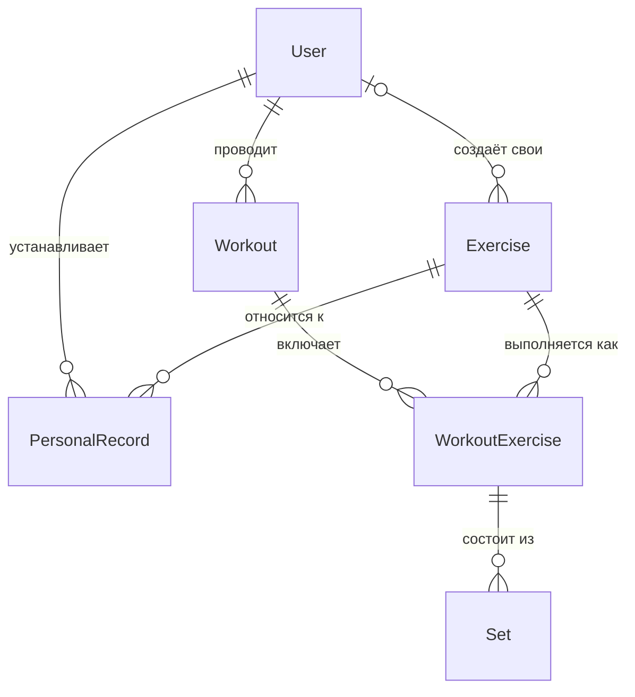

# PowerLog

REST API для дневника тренировок по пауэрлифтингу: тренировки, упражнения, подходы и личные рекорды.
Учебно-портфолио проект, разрабатываемый самостоятельно на **C# / ASP.NET Core**.

> **Статус:** в активной разработке. Ниже честно указано, что уже работает, а что ещё нет ([см. статус](#статус-проекта)).

## Что показывает этот проект

| Тема | Как реализовано |
|---|---|
| Многослойная архитектура | `Api` → `Core` ← `Infrastructure`, зависимости направлены внутрь, бизнес-логика не знает про EF Core |
| Работа с БД | EF Core 10 (Code First), PostgreSQL в Docker Compose, миграции, имена таблиц и колонок в snake_case, аудит-поля (`CreatedAt/By`, `UpdatedAt/By`) заполняются автоматически в `SaveChangesAsync` |
| Изоляция данных пользователей | Каждый пользователь видит системные упражнения и только свои; чужие данные недоступны (404), системные упражнения защищены от изменения (403) |
| Сохранение истории | Гибридное удаление упражнений: неиспользованное удаляется физически, использованное в тренировках или рекордах — мягко (`IsDeleted`), история не теряется; связи с упражнениями защищены `Restrict` |
| Паттерны доступа к данным | Repository + Unit of Work; чтение (`IReader`, `AsNoTracking`) отделено от записи (`IWriter`) |
| Аутентификация | JWT Bearer, пароли хешируются BCrypt |
| Тестируемость | Зависимости от времени и текущего пользователя вынесены в `IDateTimeProvider` и `IIdentityProvider`; все даты хранятся в UTC |
| Контракты API | DTO отделены от доменных моделей, маппинг через AutoMapper, валидация через Data Annotations, документация в Swagger |

## Стек

- .NET 10, ASP.NET Core Web API (контроллеры)
- Entity Framework Core 10 + PostgreSQL 17 (Npgsql, EFCore.NamingConventions)
- Docker Compose для локальной базы данных
- JWT Bearer (`Microsoft.AspNetCore.Authentication.JwtBearer`), BCrypt.Net-Next
- AutoMapper, Swashbuckle (Swagger UI)

## Архитектура

```
PowerLog.Api             Контроллеры, Program.cs (DI, JWT, CORS, Swagger), провайдеры времени и пользователя
PowerLog.Core            Модели, DTO, интерфейсы репозиториев и сервисов, сервисы с бизнес-логикой, профиль маппинга
PowerLog.Infrastructure  DbContext, репозитории, Reader/Writer/UnitOfWork, миграции EF Core
```

Поток запроса: `Controller → Service → Repository → DbContext`.

### Модель данных



Упражнение без владельца (`UserId = null`) — системное, общее для всех: приседания, жим лёжа, становая тяга.
Тип упражнения (`ExerciseType`): `Squat`, `BenchPress`, `DeadLift`, `Accessory`.

## Быстрый старт

**Требования:** .NET 10 SDK, Docker.

```bash
git clone https://github.com/hermit2202/PowerLog.git
cd PowerLog

# 1. поднять PostgreSQL в контейнере
docker compose up -d

# 2. восстановить dotnet-ef (версия закреплена в dotnet-tools.json) и применить миграции
dotnet tool restore
dotnet ef database update --project PowerLog.Infrastructure --startup-project PowerLog.Api

# 3. запустить API
dotnet run --project PowerLog.Api
```

Swagger UI (в режиме Development): http://localhost:5152/swagger

Строка подключения для локальной разработки лежит в `appsettings.Development.json` и совпадает с настройками из `docker-compose.yml`.
При первом запуске создаётся тестовый пользователь `test@example.com` / `password123`.

Для другого окружения строку подключения и JWT-ключ (не короче 32 символов) можно передать через переменные окружения:

```bash
export ConnectionStrings__DefaultConnection="Host=<хост>;Port=5432;Database=powerlog;Username=<пользователь>;Password=<пароль>"
export JwtSettings__SecretKey="<случайная строка не короче 32 символов>"
```

### Пример использования

```bash
# регистрация
curl -X POST http://localhost:5152/api/users/register \
  -H "Content-Type: application/json" \
  -d '{"userName":"athlete","email":"athlete@example.com","password":"strongpass1"}'

# вход (в ответе поле jwtToken)
curl -X POST http://localhost:5152/api/users/login \
  -H "Content-Type: application/json" \
  -d '{"email":"athlete@example.com","password":"strongpass1"}'

# создание своего упражнения (type: 0 Squat, 1 BenchPress, 2 DeadLift, 3 Accessory)
curl -X POST http://localhost:5152/api/exercises \
  -H "Authorization: Bearer <jwtToken>" -H "Content-Type: application/json" \
  -d '{"name":"Жим гантелей","type":3}'
```

Полный сценарий проверки API (изоляция пользователей, коды 403/404/409, мягкое удаление) — в файле `PowerLog.Api/PowerLog.Api.http`, запускается из Rider или VS Code.

## API

Все эндпоинты, кроме регистрации и входа, требуют заголовок `Authorization: Bearer <token>`.

| Ресурс | Методы |
|---|---|
| `/api/users` | `POST /register`, `POST /login`, `GET /me` |
| `/api/exercises` | `GET`, `GET /{id}`, `POST`, `PUT /{id}`, `DELETE /{id}` |
| `/api/workouts` | `GET`, `GET /{id}`, `POST`, `PUT /{id}`, `DELETE /{id}` |
| `/api/personalrecords` | `GET ?exerciseId=`, `GET /{id}`, `POST`, `PUT /{id}`, `DELETE /{id}` |

## Статус проекта

**Реализовано**
- Регистрация, вход, JWT-аутентификация
- CRUD для упражнений, тренировок и личных рекордов
- Системные и пользовательские упражнения, проверка владельца на всех эндпоинтах
- Гибридное (мягкое) удаление упражнений с сохранением истории
- PostgreSQL в Docker Compose, миграции БД, автоматический аудит изменений

**В работе**
- Единая обработка ошибок (`ProblemDetails`) и валидация
- API для упражнений внутри тренировки и подходов (сущности и репозитории готовы, сервисов и эндпоинтов пока нет)

**Пока не реализовано**
- Тесты, Docker-образ API, CI
- Расчёт статистики (тоннаж, прогресс)

## Планы

1. Подходы и упражнения в тренировке, статистика: тоннаж за тренировку и за неделю, оценка 1ПМ
2. Тесты (xUnit, интеграционные на `WebApplicationFactory`), Docker-образ API, GitHub Actions
3. Роли «спортсмен / тренер»: спортсмен даёт тренеру временный ключ доступа, тренер видит тренировки и отправляет план
4. Дневник питания
5. Клиент: Telegram-бот / Mini App

## Автор

Студент 3 курса ПКГХ (Санкт-Петербург), специальность «Информационные системы и программирование».
GitHub: [hermit2202](https://github.com/hermit2202)
